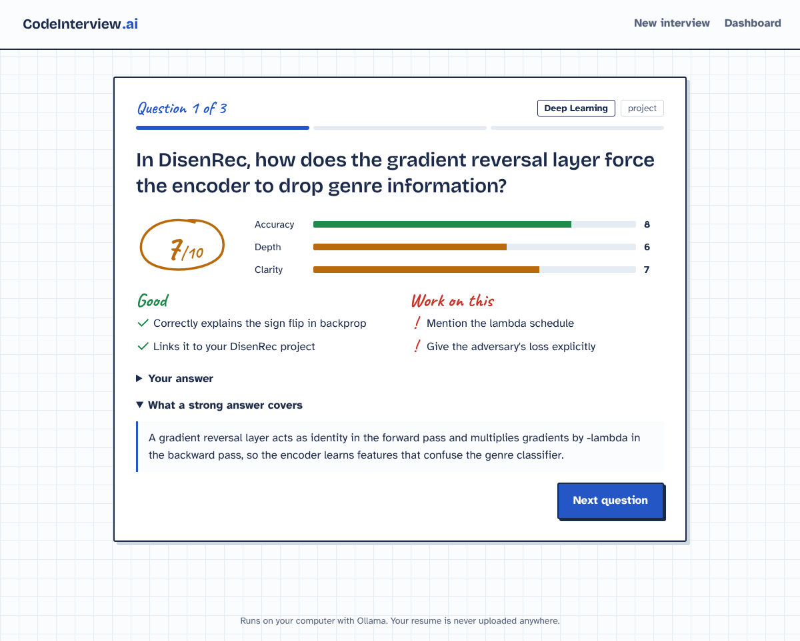
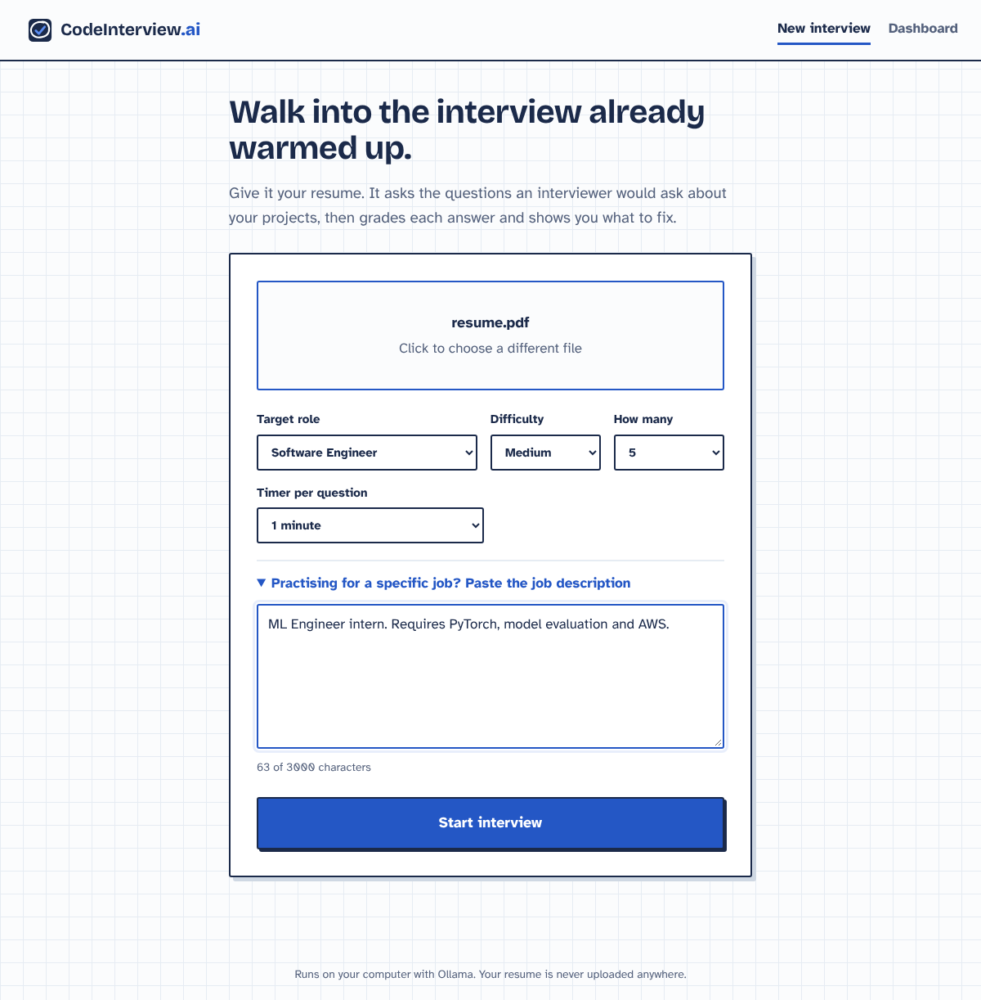
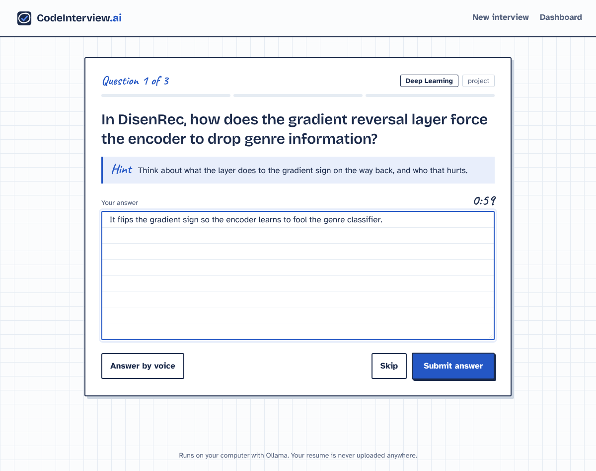
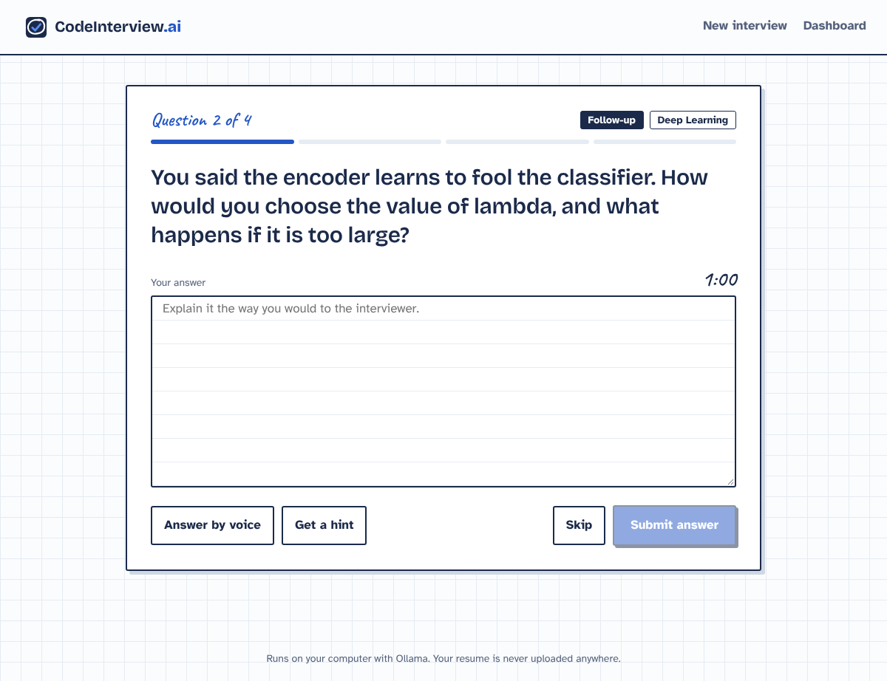
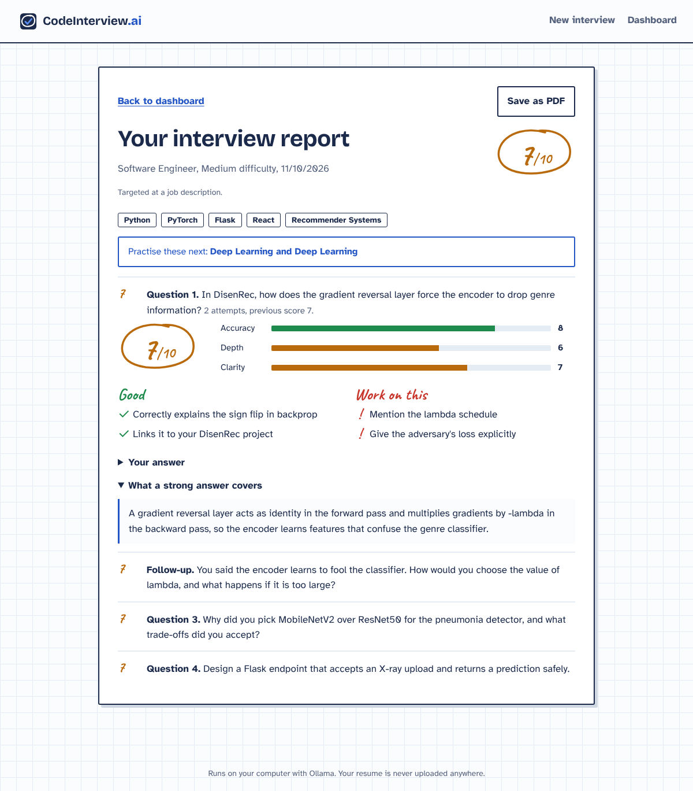
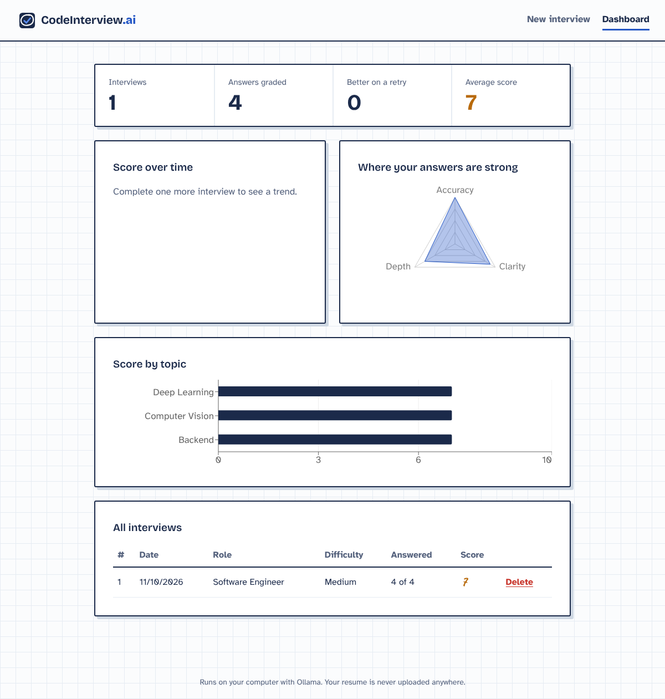

<!-- profile-card:start -->
<p align="center">
  <a href="https://github.com/YashasRajR"></a>
</p>
<!-- profile-card:end -->

# CodeInterview AI

An AI mock-interview platform that reads your resume, asks technical questions about **your** projects and skills, evaluates each answer, and tracks your progress over time. It runs entirely on your own computer: the LLM runs locally through [Ollama](https://ollama.com), so it needs **no API key** and your resume never leaves your machine.



## Features

- **Resume → tailored questions:** upload a PDF resume, pick a role and difficulty, and get questions about the projects and skills it mentions (concepts, project deep-dives, problem solving).
- **Job description targeting:** optionally paste a job posting, and questions focus on the skills it asks for.
- **Interview timer:** an optional countdown per question (1–5 minutes). Time per answer is recorded.
- **Hints:** a one-line nudge when you're stuck, without giving the answer away.
- **Follow-up questions:** after answering, the interviewer can dig into the weakest part of your answer, like a real interviewer.
- **Try again:** re-answer any question and see whether your score went up.
- **Save as PDF:** export the full interview report with all feedback.
- **Answer evaluation:** every answer is scored out of 10 on accuracy, depth and clarity, with strengths, specific improvements and a model answer.
- **Voice answers:** answer by speaking, using the browser's Web Speech API (Chrome or Edge).
- **Performance dashboard:** score trend across interviews, an answer-quality radar, average score by topic, and full past reports.
- **Private by design:** local LLM (Llama 3.2 by default) and local SQLite storage.

## Tech stack

| Layer | Tech |
|---|---|
| Frontend | React 18, Vite, Recharts, Web Speech API |
| Backend | Python, Flask, REST API, SQLite |
| AI | Ollama (local LLM, default `llama3.2:3b`), JSON-structured prompting |
| Resume parsing | pypdf |
| Testing | pytest (LLM mocked) |

## Architecture

```
React (Vite, :5173) ──/api──▶ Flask (:5000) ──▶ Ollama (:11434, local LLM)
                                   │
                                   └──▶ SQLite (sessions, answers, scores)
```

## Setup

You need **Python 3.10+**, **Node.js 18+** and **Ollama**.

**1. Install Ollama and a model**

Download Ollama from https://ollama.com/download, then run:

```bash
ollama pull llama3.2:3b
```

(This needs about 2 GB of disk space and 8 GB of RAM. For better questions on a stronger PC, try `ollama pull qwen2.5:7b` and set `OLLAMA_MODEL=qwen2.5:7b`.)

**2. Backend**

```bash
cd backend
python -m venv venv
venv\Scripts\activate        # Windows  (macOS/Linux: source venv/bin/activate)
pip install -r requirements.txt
python app.py                # http://localhost:5000
```

**3. Frontend** (in a second terminal)

```bash
cd frontend
npm install
npm run dev                  # http://localhost:5173
```

Open http://localhost:5173. On Windows, after the first install you can simply double-click **`start.bat`**.

## Configuration

| Variable | Default | Purpose |
|---|---|---|
| `OLLAMA_MODEL` | `llama3.2:3b` | Which local model to use |
| `OLLAMA_URL` | `http://localhost:11434` | Ollama server address |
| `OLLAMA_TIMEOUT` | `180` | Seconds to wait for the model |
| `DB_PATH` | `backend/codeinterview.db` | SQLite file location |

## API

| Method | Endpoint | Description |
|---|---|---|
| GET | `/api/health` | Checks Ollama and the model |
| POST | `/api/interviews` | Upload resume (multipart: `resume`, `role`, `difficulty`, `count`, optional `job_description`, `time_limit`) → session with questions |
| GET | `/api/interviews` | List past interviews |
| GET | `/api/interviews/<id>` | One interview with answers and feedback |
| POST | `/api/interviews/<id>/questions/<qid>/answer` | Submit `{ "answer": "...", "time_seconds": 42 }` → score and feedback (re-submitting is a retry) |
| POST | `/api/interviews/<id>/questions/<qid>/hint` | One-line hint (cached per question) |
| POST | `/api/interviews/<id>/questions/<qid>/followup` | Insert a follow-up question after an answered question |
| POST | `/api/interviews/<id>/complete` | Mark interview finished |
| DELETE | `/api/interviews/<id>` | Delete an interview |
| GET | `/api/stats` | Dashboard statistics |

## Tests

```bash
cd backend
pytest -q
```

The tests mock the LLM, so Ollama doesn't need to be running.

## Screenshots

| Setup | Hint and timer | Follow-up |
|---|---|---|
|  |  |  |

| Report | Dashboard |
|---|---|
|  |  |

## Limitations

- Scores come from an LLM and are a practice guide, not an objective grade. Small local models can be inconsistent.
- Scanned (image-only) PDF resumes can't be read; use a text-based PDF.
- Voice input only works in Chromium-based browsers.

## Author

**Yashas Raj R**: [GitHub](https://github.com/YashasRajR)
